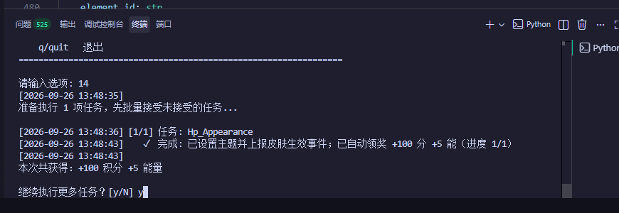

# 🖱️  WorkBuddy 成长任务一键完成

**workbuddy-task-auto** —— 读取本机 WorkBuddy 桌面端登录会话，把官方「成长计划」中**可纯 API 完成**的
成长任务做成**编号菜单**，按输入数字完成指定任务，执行后**回读进度并自动领奖**。

- 🖱️ **菜单交互**：无参数运行即展示任务菜单
- 🔢 **按编号执行**：支持单选、多选、区间、全选
- 🔁 **回读 + 自动领奖**：执行动作后轮询回读进度（上游计分异步），达标即自动领取奖励
- 🔒 **零第三方依赖**：仅用 Python 标准库；token 仅在内存中使用，不写日志、不外传
- ♻️ **幂等安全**：已完成 / 已领取的任务自动跳过，重复运行不重复扣资源


> 📌 **核心逻辑参考自 [`linguo2625469/workbuddy2api-panel`](https://github.com/linguo2625469/workbuddy2api-panel)**。
> 原库仅支持「一键完成所有任务」，本脚本重构为`Python`，并**增加了按编号可选执行**的能力——
> 可只完成指定任务（单选 / 多选 / 区间 / 全选）。

---

## 运行预览



> 输入编号 `14` 执行 `Hp_Appearance`：调用设置主题 API + 上报皮肤生效事件，
> 执行后**自动领奖 `+100 分 +5 能`**（进度 1/1），本次共获得 `+100 积分 +5 能量`。

---

## 快速开始

### 环境要求

- Python **3.10+**
- 本机已登录 **WorkBuddy / CodeBuddy 桌面端**（脚本从桌面端登录会话读取凭据）

### 运行

```bash
python workbuddy_task.py            # 交互式菜单（循环输入，可连续执行）
python workbuddy_task.py list       # 仅列出任务编号，不执行
python workbuddy_task.py all        # 一键完成全部任务（全选）
python workbuddy_task.py 3          # 只完成第 3 项任务（单选）
python workbuddy_task.py 1 3 5      # 完成第 1、3、5 项（多选）
python workbuddy_task.py 1-5        # 完成第 1~5 项（区间）
python workbuddy_task.py chat_5     # 直接按任务代码（task_code）执行
```

交互式菜单支持同样的输入：

| 输入 | 含义 |
|---|---|
| `1` | 执行第 1 项任务 |
| `1 3 5` 或 `1,3,5` | 执行第 1、3、5 项（多选，空格或逗号分隔） |
| `1-10` | 执行第 1~10 项（区间） |
| `all` | 执行全部任务（全选） |
| `list` | 仅列出任务，不执行 |
| `q` / 回车 | 退出 |

---

## 执行流程

```
读取任务状态 → 已完成/已领取则跳过 → 执行对应判据事件链
            → 有界轮询回读进度（等待异步计分）→ 达标即自动领奖
```

- 执行选定任务前，会先把该账号**未接受的任务批量报名**（`accept`），使状态流转规范；
- 行为事件上报后，上游计分是**异步**的（通常数秒后刷新），脚本会**轮询回读**再决定是否领奖；
- 领奖走 Web 成长中心接口 `POST /activity/growth/tasks/<task_code>/claim`（任务码在路径）。

## 任务清单

| 编号 | `task_code` | 说明 | 奖励 |
|---:|---|---|---|
| 1 | `chat_5` | 上报 5 条对话活跃事件（自动补足差额） | +100c |
| 2 | `first_buddy` | 前置上报 → 同意协议 → 领取第一只 Buddy | +300c +8e |
| 3 | `Model_chat_GLM5.2` | accept → glm-5.2 真实对话 → 对齐模型上报 | +100c +5e |
| 4 | `RichMeow_Chat` | 桌面端指纹完整对话事件链（纯 API 可点亮） | +100c +5e +UR Buddy |
| 5 | `Buddy_App` | 上报「进入 Buddy 应用」事件链（纯 API 可点亮） | +100c +5e |
| 6 | `Buddy_App_QQ` | 上报「进入企鹅教师助手」事件链（与 5 共用） | +50c +5e |
| 7 | `automation_1` | 上报「定时任务创建」事件（纯 API 可点亮） | +100c +5e |
| 8 | `Library_read` | 上报「资料库介绍阅读」事件（web 域） | +100c +5e |
| 9 | `template_5` | 上报「使用模板创建任务」事件组 ×5 | +100c +5e |
| 10 | `playbook_prompt` | 上报「灵感案例做同款发送 Prompt」事件组 | +100c +5e |
| 11 | `create_canvas` | 上报「设计创意画布创建」事件组 | +300c +5e |
| 12 | `expert_5` | 真实专家召唤 + 使用链 ×5 | +100c +5e |
| 13 | `Expert_team_use_3` | 真实专家团召唤 + 使用链 ×3 | +100c +5e |
| 14 | `Hp_Appearance` | 设置主题 API + 皮肤生效事件 | +100c +5e |
| 15 | `skill_1` | 真实对话 + `skill_info` 技能加载事件 | +100c +5e |
| 16 | `Expert_lighthouse` | 腾讯轻量云专家召唤 + 使用链 | +100c +5e |
| 17 | `black_cat` | 夜猫子（**尝试型**）：23:00–08:00 窗口内 glm-5.2 对话补足 | — |
| 18 | `school_season` | 校园日（小程序口径）：mini 对话 + activityId | +100c +5e |
| 19 | `Sequential_Tasks_1` | 小程序首对话 | +100c +5e |
| 20 | `Sequential_Tasks_2` | 小程序选中专家对话 | +200c +5e |
| 21 | `Sequential_Tasks_3` | 小程序五次对话 | +300c +5e |
| 22 | `Sequential_Tasks_4` | 小程序定时任务（每日零点解锁一环，PC 同源事件） | — |
| 23 | `Sequential_Tasks_5` | 小程序使用 GLM5.2（mp 模型字段对话事件） | — |
| 24 | `Sequential_Tasks_6` | 小程序十次对话（自动补差额） | — |
| 25 | `Sequential_Tasks_7` | 体验灵感功能（PC + mp 双形态事件组） | — |

> 编号与脚本内 `TASK_TABLE` 一一对应（共 **25** 项）。**全新账号除 `black_cat` 外一键全做完
> ≈ +1950 积分 +78 能量**。仅少数任务涉及真实对话（`Model_chat_GLM5.2`、`expert_5` /
> `Expert_team_use_3` / `skill_1` 各数条 `fast-model` 短对话），其余全部为行为事件上报，
> **零对话消耗**。

### 需注意的任务

| 任务 | 说明 |
|---|---|
| `black_cat`（夜猫子，#17） | 需在 **23:00–08:00** 本地时间窗口内执行才计分；窗口外执行会提示稍后重试 |

### 不可自动完成的任务

| 任务 | 原因 |
|---|---|
| `Expert_Philanthropy` | 需真实捐款，服务端领奖时校验捐赠回执，无法绕过 |

---

## 登录会话

脚本按平台自动探测 WorkBuddy 桌面端写出的凭据文件，无需输入账号密码：

| 平台 | 路径 |
|---|---|
| Windows | `%LOCALAPPDATA%\CodeBuddyExtension\Data\Public\auth\workbuddy-desktop.info` |
| macOS | `~/Library/Application Support/CodeBuddyExtension/Data/Public/auth/workbuddy-desktop.info` |
| Linux | `~/.config/CodeBuddyExtension/Data/Public/auth/workbuddy-desktop.info` |
| 兜底 | `~/.workbuddy/auth/workbuddy-desktop.info` |

自定义路径用环境变量指定：

```powershell
# Windows (PowerShell)
$env:WORKBUDDY_AUTH_FILE = "D:\path\to\workbuddy-desktop.info"
```

```bash
# macOS / Linux
export WORKBUDDY_AUTH_FILE="/path/to/workbuddy-desktop.info"
```

| 环境变量 | 作用 |
|---|---|
| `WORKBUDDY_AUTH_FILE` | 覆盖桌面端凭据文件路径 |

---

## 实现原理（简述）

成长任务的计分走 `/v2/report` 行为上报，但**不同任务认不同客户端指纹**：

- **CLI / billing 指纹**（`www.codebuddy.cn`）：`chat_5`、`Model_chat_GLM5.2` 等活跃上报；
- **桌面指纹**（`copilot.tencent.com` + `WorkBuddy/5.5.6` UA + `workbuddy-desktop` 事件族）：
  `RichMeow_Chat`、`Buddy_App`、`automation_1`、`template_5`、`playbook_prompt`、`create_canvas` 等；
- **web 指纹**（`www.workbuddy.cn` + `x-client-platform: web`）：`Library_read` 等页面行为类；
- **小程序指纹**（`X-Client-Platform: miniprogram`）：`school_season`、`Sequential_Tasks_*`。

专家类任务额外要求**真实专家 id**（从专家市场拉取）与**真实对话回执**（服务端 `requestId`）。
调用的接口均为 CodeBuddy 官方客户端使用的非公开接口。

---

## ⚠️ 安全与合规

- **凭据**：脚本读取桌面端凭据文件中的 `accessToken`，**仅在内存中使用**，不写入日志、不外传；
- **网络**：所有请求仅发往官方域名（`copilot.tencent.com` / `www.codebuddy.cn` / `www.workbuddy.cn`）；
- **边界**：仅限**本人授权账号**、本机 / 私有环境使用，不得共享、转售或违规分发；
- **风险**：自动化请求可能触发上游风控，请遵守平台服务条款并自行承担使用风险。

## 免责声明

本脚本仅供学习与研究使用。使用者需自行遵守 CodeBuddy / WorkBuddy 平台的服务条款，
自行承担账号封禁、条款违约等一切风险。作者不对任何因使用本项目产生的直接或间接损失负责。

## 🙏 致谢与来源

本项目的「成长任务一键完成」逻辑来自以下上游开源项目（均为 MIT License）：

| 项目 | 说明 |
|---|---|
| [Sliverkiss/workbuddy2api](https://github.com/Sliverkiss/workbuddy2api) | 原始项目 |
| [linguo2625469/workbuddy2api-panel](https://github.com/linguo2625469/workbuddy2api-panel) | 增强分支（Go 版网关 + Web 面板） |

- 若再分发，请保留上游项目的版权与许可声明（见 [`LICENSE`](./LICENSE)）。

## 📄 许可证

本项目采用 **[MIT License](./LICENSE)** 开源协议。

- 允许任意使用、复制、修改、合并、发布、分发、再授权及销售；
- 再分发（源码或二进制形式）时，请保留版权声明与许可声明；
- 本项目**不授予**任何上游（CodeBuddy / 腾讯）接口或服务的权利，使用者仍需自行遵守上游服务条款。
